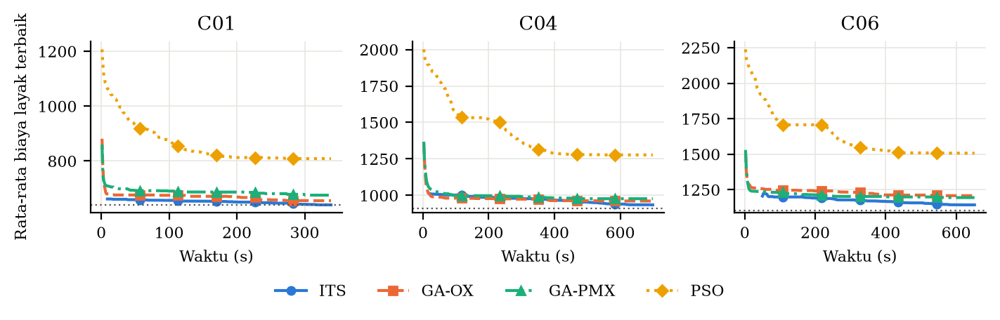
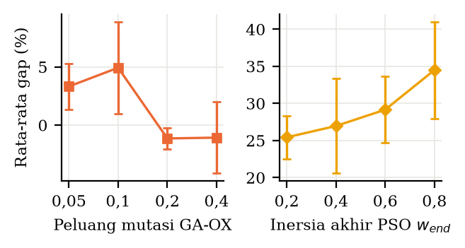

# GA dan PSO untuk MC-TTRP

Folder ini berisi implementasi Genetic Algorithm (GA) dan Particle Swarm Optimization (PSO) untuk *Multi-Compartment Truck and Trailer Routing Problem* (MC-TTRP), beserta script eksperimen dan analisisnya. Hasilnya dibandingkan dengan Iterated Tabu Search (ITS) dari paper Davila-Pena dkk. (2023), yang kodenya ada di `../its_mcttrp/`.

**Persoalannya:** sebuah koperasi mengirim pakan ternak memakai truk yang bisa menarik trailer. Sebagian pelanggan (TC) hanya bisa didatangi truk tanpa trailer, sehingga trailer diparkir di pelanggan lain (VC) dan truk melanjutkan sendiri. Setiap kendaraan punya kompartemen (*hopper*), dan satu hopper hanya boleh berisi satu produk untuk satu pelanggan. Tujuannya adalah meminimalkan total jarak tempuh.

**Paper acuan:** L. Davila-Pena, D. R. Penas, B. Casas-Méndez, "A new two-phase heuristic for a problem of food distribution with compartmentalized trucks and trailers," *International Transactions in Operational Research* 30(2):1031–1064, 2023. https://doi.org/10.1111/itor.13071

## Cara kerja

- Solusi dikodekan sebagai **permutasi pelanggan**.
- **Decoder** (`mcttrp/decoder.py`) memotong permutasi menjadi rute PTR, PVR, atau MVR dengan *split* DP, sambil memeriksa kapasitas hopper dan batas armada. Kalau armada tidak cukup, solusi diberi penalti.
- **GA** (`ga.py`): seleksi turnamen, crossover OX atau PMX, mutasi inversi, dan elitisme.
- **PSO** (`pso.py`): posisi partikel berupa *random key* yang diurutkan menjadi permutasi, dengan bobot inersia yang turun linear.
- Setiap solusi akhir diperiksa ulang oleh **validator** independen (`mcttrp/solution.py`), dan biayanya dihitung ulang.

## Struktur folder

| Path | Isi |
| --- | --- |
| `data/` | Dataset: `P1.csv`–`P8.csv` (data nyata koperasi) dan `CHAO_MCTTRP_*.txt` (benchmark Chao). Isinya identik dengan `../its_mcttrp/instances/`. |
| `mcttrp/instance.py` | Membaca file instance |
| `mcttrp/decoder.py` | Decoder permutasi menjadi rute |
| `mcttrp/solution.py` | Representasi rute, perhitungan biaya, dan validator |
| `mcttrp/its_parse.py` | Membaca hasil ITS dari R (JSON) |
| `ga.py` | Genetic Algorithm |
| `pso.py` | Particle Swarm Optimization |
| `run_experiments.py` | Menjalankan semua run GA dan PSO |
| `compare.py` | Membuat tabel, uji statistik, dan grafik perbandingan |
| `tests/` | Unit test (pytest) |
| `requirements.txt` | Dependensi Python |

Parameter algoritma, daftar instance, armada, nilai acuan, dan seed diatur di `../config.json`.

## Instalasi

Jalankan dari folder ini:

```bash
python3 -m venv .venv
source .venv/bin/activate
pip install -r ga_pso/requirements.txt
```

Butuh Python 3.11 atau lebih baru. Di Windows, aktifkan venv dengan `.venv\Scripts\Activate.ps1`.

## Jalankan

### Coba satu algoritma pada satu instance

Dari folder `ga_pso/`:

```python
from mcttrp.instance import load_instance
from mcttrp.decoder import Decoder
from mcttrp.solution import validate
from ga import run_ga
from pso import run_pso

inst = load_instance("data/P1.csv", n_trucks=2, n_trailers=1)
dec = Decoder(inst)

res = run_ga(dec, seed=1, time_limit_s=5, crossover="OX")   # atau crossover="PMX"
routes = dec.routes(res["best_perm"])
print(res["best_cost"], validate(inst, routes))           # 189.0 (True, 'ok')

res = run_pso(dec, seed=1, time_limit_s=5)
print(res["best_cost"])
```

Run pertama sedikit lebih lama karena numba meng-compile fungsi decoder.

### Eksperimen lengkap

Dari folder ini:

```bash
python ga_pso/run_experiments.py                  # GA-OX, GA-PMX, PSO: 14 instance x 10 seed
python ga_pso/run_experiments.py --sensitivity    # analisis sensitivitas pada CHAO_MCTTRP_01
python ga_pso/compare.py                          # tabel, uji Wilcoxon, dan grafik
```

- `run_experiments.py` butuh hasil ITS di `../results/raw/its/`, karena batas waktu setiap run GA/PSO sama dengan rata-rata waktu ITS di instance yang sama. Hasil ITS dibuat oleh `python run_its_batch.py` (lihat README utama).
- Opsi `--only P1.csv,P2.csv` menjalankan instance tertentu saja.
- Run yang sudah punya file hasil akan dilewati, jadi script aman dihentikan lalu dijalankan lagi.
- Eksperimen lengkap butuh sekitar 3 jam dengan 8 proses paralel. Jumlah proses diatur lewat `workers` di `config.json`.

### Hasil

| Output | Isi |
| --- | --- |
| `../results/raw/GA-OX/`, `GA-PMX/`, `PSO/` | Satu JSON per run: biaya, rute, jumlah evaluasi, dan kurva konvergensi |
| `../results/summary.csv` | Terbaik, rata-rata, simpangan baku, terburuk, dan gap per instance dan algoritma |
| `../results/stats.csv` | Uji Wilcoxon rank-sum |
| `../results/sensitivity.csv` | Analisis sensitivitas |
| `../report/figures/`, `../report/tables/` | Grafik dan tabel LaTeX untuk laporan |

## Hasil eksperimen

Setiap algoritma dijalankan 10 kali (seed 1–10) per instance. GA dan PSO diberi batas waktu yang sama dengan rata-rata waktu ITS (metode paper) di instance tersebut. Gap dihitung dengan rumus (hasil − acuan) / acuan × 100%. Acuannya adalah optimum Gurobi untuk P1–P8 dan hasil ITS terbaik di paper untuk instance Chao. Semua 560 solusi akhir lolos validator.

**Rata-rata biaya (km) pada instance Chao.** Angka lebih kecil berarti lebih baik.

| Instance | Acuan (paper) | ITS (paper) | GA-OX | GA-PMX | PSO |
| --- | ---: | ---: | ---: | ---: | ---: |
| C01 (50 pelanggan) | 640,66 | **640,08** | 655,27 | 675,34 | 808,76 |
| C02 (50 pelanggan) | 708,08 | **723,55** | 745,56 | 753,68 | 879,00 |
| C03 (50 pelanggan) | 764,81 | **777,35** | 787,63 | 808,55 | 925,44 |
| C04 (75 pelanggan) | 908,53 | **934,80** | 961,26 | 976,84 | 1277,36 |
| C05 (75 pelanggan) | 1012,83 | **1029,39** | 1083,65 | 1078,55 | 1326,97 |
| C06 (75 pelanggan) | 1101,90 | **1143,67** | 1208,44 | 1194,90 | 1507,57 |
| Rata-rata gap | | 2,0% | 5,5% | 6,7% | 30,0% |

Di data nyata P1–P8, semua algoritma hampir selalu mencapai optimum. Rata-rata gap-nya 0,6% untuk ITS, 0,2% untuk GA-OX dan GA-PMX, serta 0,3% untuk PSO.

### Gap per instance


Satu kelompok batang mewakili satu instance, dan satu warna mewakili satu algoritma. Makin rendah batang, makin dekat solusinya ke acuan. Di P1–P8 semua batang hampir nol. Di instance Chao, ITS (biru) paling rendah, GA (oranye dan hijau) sedikit di atasnya, dan PSO (kuning) jauh lebih tinggi.

### Kurva konvergensi



Grafik ini menunjukkan biaya terbaik yang sudah ditemukan seiring waktu, dirata-ratakan atas 10 run. Garis titik-titik adalah nilai acuan. GA turun sangat cepat di detik-detik awal lalu mendatar, karena populasinya cepat seragam. ITS mulai dari solusi Clarke–Wright yang sudah bagus dan terus turun pelan sampai akhir. PSO turun paling lambat dan berhenti jauh di atas.

### Contoh solusi (C01)


Garis biru adalah perjalanan truk bersama trailer, garis oranye putus-putus adalah perjalanan truk setelah trailer diparkir, dan garis ungu adalah rute truk tanpa trailer. Semua TC (lingkaran putih) dilayani truk tanpa trailer. Solusi terbaik GA-OX (628,86 km) sedikit lebih pendek daripada ITS terbaik (633,61 km) dan nilai terbaik di paper (640,66 km).

### Sensitivitas parameter (C01)



Peluang mutasi GA yang terlalu kecil (0,05–0,1) membuat GA cepat macet. Nilai 0,2–0,4 memberi hasil jauh lebih baik. Pada PSO, inersia akhir yang lebih kecil sedikit lebih baik, tetapi gap-nya tetap di atas 25%.

### Kesimpulan singkat

- ITS dari paper memberi rata-rata terbaik di semua instance Chao. Selisihnya dengan GA tidak signifikan di C01, C03, dan C04 (uji Wilcoxon, p > 0,05).
- GA sesekali menemukan solusi lebih pendek daripada paper (C01 dan C03), tetapi hasilnya kurang stabil antar run.
- PSO dengan random key tertinggal jauh (rata-rata gap 21–41% di instance Chao).
- Crossover OX dan PMX tidak berbeda signifikan.

Pembahasan lengkap ada di laporan `../report/main.tex`.

## Test

```bash
cd ga_pso
../.venv/bin/pytest -q
```

Test memeriksa parser instance, validator (termasuk solusi optimal 207 km dari Section 5.1 paper), decoder, operator GA dan PSO, runner eksperimen, dan memastikan dataset di `data/` identik dengan dataset ITS.
