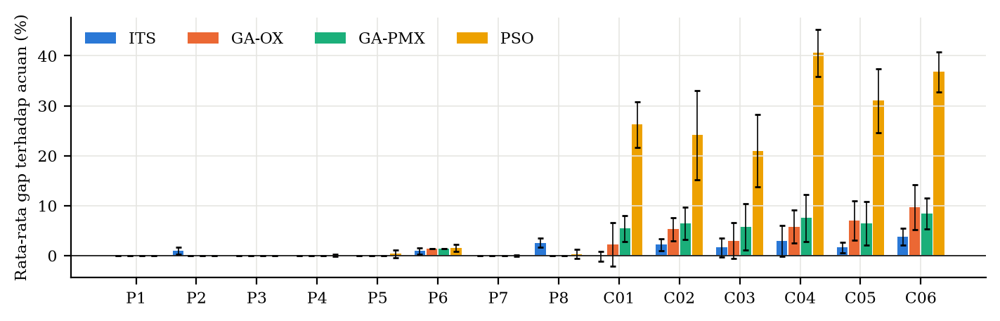
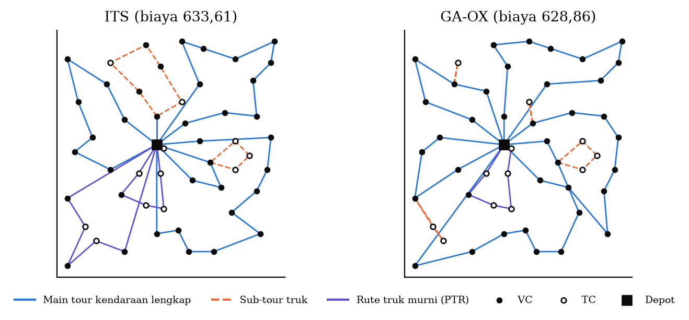

# Tugas Besar 1: Problem Solving Agent

**Mata kuliah:** AI5103 Artificial Intelligence and Data Science Fundamental

Proyek ini mempelajari persoalan rute truk dan trailer dengan kendaraan multi-kompartemen (*Multi-Compartment Truck and Trailer Routing Problem*, MC-TTRP). Folder ini berisi implementasi Genetic Algorithm (GA) dan Particle Swarm Optimization (PSO), beserta script eksperimen dan analisisnya. Hasilnya dibandingkan dengan metode paper, yaitu Clarke–Wright yang dilanjutkan Iterated Tabu Search (ITS).

## Anggota Kelompok

| NIM | Nama |
| --- | --- |
| 28426006 | Muhammad Faishal Dienul Haq |
| 28426013 | Naufal Izza Fikry |

**Paper acuan:** [A new two-phase heuristic for a problem of food distribution with compartmentalized trucks and trailers](https://doi.org/10.1111/itor.13071), Laura Davila-Pena, David R. Penas, dan Balbina Casas-Méndez, 2023.

**Kode dan data asli paper:** https://github.com/LauraDavilaPena/ITS_MC-TTRP

## Persoalan

Sebuah koperasi di Spanyol mengirim pakan ternak memakai truk yang bisa menarik trailer. Sebagian pelanggan (TC) hanya bisa didatangi truk tanpa trailer, sehingga trailer diparkir di pelanggan lain (VC) dan truk melanjutkan sendiri. Setiap kendaraan punya kompartemen (*hopper*), dan satu hopper hanya boleh berisi satu produk untuk satu pelanggan. Tujuannya adalah meminimalkan total jarak tempuh.

## Cara kerja

- Solusi dikodekan sebagai **permutasi pelanggan**.
- **Decoder** (`mcttrp/decoder.py`) memotong permutasi menjadi rute PTR, PVR, atau MVR dengan *split* DP, sambil memeriksa kapasitas hopper dan batas armada. Kalau armada tidak cukup, solusi diberi penalti.
- **GA** (`ga.py`): seleksi turnamen, crossover OX atau PMX, mutasi inversi, dan elitisme.
- **PSO** (`pso.py`): posisi partikel berupa *random key* yang diurutkan menjadi permutasi, dengan bobot inersia yang turun linear.
- Setiap solusi akhir diperiksa ulang oleh **validator** independen (`mcttrp/solution.py`), dan biayanya dihitung ulang. Validator yang sama juga dipakai untuk memeriksa solusi ITS.

## Struktur folder

| Path | Isi |
| --- | --- |
| `data/` | Dataset dari repo paper: `P1.csv`–`P8.csv` (data nyata koperasi) dan `CHAO_MCTTRP_*.txt` (benchmark Chao). `SHA256SUMS` memastikan isinya sama dengan file asli. |
| `config.json` | Daftar instance, armada, nilai acuan, seed, dan parameter GA/PSO |
| `mcttrp/` | Pembaca instance, decoder, validator, dan pembaca hasil ITS |
| `ga.py`, `pso.py` | Genetic Algorithm dan Particle Swarm Optimization |
| `run_experiments.py` | Menjalankan semua run GA dan PSO |
| `compare.py` | Membuat tabel, uji statistik, dan grafik perbandingan |
| `results/raw/` | Hasil mentah, satu JSON per run (ITS, GA-OX, GA-PMX, PSO, sensitivitas) |
| `results/*.csv` | Ringkasan hasil dan uji statistik |
| `results/figures/`, `results/tables/` | Grafik (PNG/PDF) dan tabel LaTeX |
| `tests/` | Unit test (pytest) |

## Instalasi

Semua perintah dijalankan dari folder `ga_pso/`. Butuh Python 3.11 atau lebih baru.

```bash
python3 -m venv .venv
source .venv/bin/activate
pip install -r requirements.txt
```

Di Windows, aktifkan venv dengan `.venv\Scripts\Activate.ps1`.

## Menjalankan

### Coba satu algoritma pada satu instance

```python
from mcttrp.instance import load_instance
from mcttrp.decoder import Decoder
from mcttrp.solution import validate
from ga import run_ga
from pso import run_pso

inst = load_instance("data/P1.csv", n_trucks=2, n_trailers=1)
dec = Decoder(inst)

res = run_ga(dec, seed=1, time_limit_s=5, crossover="OX")   # atau crossover="PMX"
routes = dec.routes(res["best_perm"])
print(res["best_cost"], validate(inst, routes))           # 189.0 (True, 'ok')

res = run_pso(dec, seed=1, time_limit_s=5)
print(res["best_cost"])
```

Run pertama sedikit lebih lama karena numba meng-compile fungsi decoder.

### Membuat ulang tabel dan grafik

```bash
python compare.py
```

Perintah ini membaca semua hasil di `results/raw/` dan menulis ulang `results/*.csv`, `results/figures/`, dan `results/tables/`. Waktunya kurang dari satu menit.

### Menjalankan ulang eksperimen

```bash
python run_experiments.py                 # GA-OX, GA-PMX, PSO: 14 instance x 10 seed
python run_experiments.py --sensitivity   # analisis sensitivitas pada CHAO_MCTTRP_01
python compare.py
```

- Batas waktu setiap run GA/PSO sama dengan rata-rata waktu ITS di instance yang sama, yang dibaca dari `results/raw/its/`.
- Hasil ITS sudah disertakan. Hasil itu dibuat dengan kode R asli dari repo paper (100 iterasi, seed 1–10), setelah beberapa perbaikan supaya bisa berjalan di R 4.6 dan macOS.
- Run yang sudah punya file hasil akan dilewati. Untuk mengulang dari awal, hapus dulu folder `results/raw/GA-OX`, `GA-PMX`, `PSO`, dan `sensitivity`.
- Opsi `--only P1.csv,P2.csv` menjalankan instance tertentu saja.
- Eksperimen lengkap butuh sekitar 3 jam dengan 8 proses paralel. Jumlah proses diatur lewat `workers` di `config.json`.

## Hasil eksperimen

Setiap algoritma dijalankan 10 kali (seed 1–10) per instance. GA dan PSO diberi batas waktu yang sama dengan rata-rata waktu ITS di instance tersebut. Gap dihitung dengan rumus (hasil − acuan) / acuan × 100%. Acuannya adalah optimum Gurobi untuk P1–P8 dan hasil ITS terbaik di paper untuk instance Chao. Semua 560 solusi akhir lolos validator.

**Rata-rata biaya (km) pada instance Chao.** Angka lebih kecil berarti lebih baik.

| Instance | Acuan (paper) | ITS (paper) | GA-OX | GA-PMX | PSO |
| --- | ---: | ---: | ---: | ---: | ---: |
| C01 (50 pelanggan) | 640,66 | **640,08** | 655,27 | 675,34 | 808,76 |
| C02 (50 pelanggan) | 708,08 | **723,55** | 745,56 | 753,68 | 879,00 |
| C03 (50 pelanggan) | 764,81 | **777,35** | 787,63 | 808,55 | 925,44 |
| C04 (75 pelanggan) | 908,53 | **934,80** | 961,26 | 976,84 | 1277,36 |
| C05 (75 pelanggan) | 1012,83 | **1029,39** | 1083,65 | 1078,55 | 1326,97 |
| C06 (75 pelanggan) | 1101,90 | **1143,67** | 1208,44 | 1194,90 | 1507,57 |
| Rata-rata gap | | 2,0% | 5,5% | 6,7% | 30,0% |

Di data nyata P1–P8, semua algoritma hampir selalu mencapai optimum. Rata-rata gap-nya 0,6% untuk ITS, 0,2% untuk GA-OX dan GA-PMX, serta 0,3% untuk PSO.

### Gap per instance



Satu kelompok batang mewakili satu instance, dan satu warna mewakili satu algoritma. Makin rendah batang, makin dekat solusinya ke acuan. Di P1–P8 semua batang hampir nol. Di instance Chao, ITS (biru) paling rendah, GA (oranye dan hijau) sedikit di atasnya, dan PSO (kuning) jauh lebih tinggi.

### Kurva konvergensi


Grafik ini menunjukkan biaya terbaik yang sudah ditemukan seiring waktu, dirata-ratakan atas 10 run. Garis titik-titik adalah nilai acuan. GA turun sangat cepat di detik-detik awal lalu mendatar, karena populasinya cepat seragam. ITS mulai dari solusi Clarke–Wright yang sudah bagus dan terus turun pelan sampai akhir. PSO turun paling lambat dan berhenti jauh di atas.

### Contoh solusi (C01)



Garis biru adalah perjalanan truk bersama trailer, garis oranye putus-putus adalah perjalanan truk setelah trailer diparkir, dan garis ungu adalah rute truk tanpa trailer. Semua TC (lingkaran putih) dilayani truk tanpa trailer. Solusi terbaik GA-OX (628,86 km) sedikit lebih pendek daripada ITS terbaik (633,61 km) dan nilai terbaik di paper (640,66 km).

### Sensitivitas parameter (C01)


Peluang mutasi GA yang terlalu kecil (0,05–0,1) membuat GA cepat macet. Nilai 0,2–0,4 memberi hasil jauh lebih baik. Pada PSO, inersia akhir yang lebih kecil sedikit lebih baik, tetapi gap-nya tetap di atas 25%.

### Kesimpulan singkat

- ITS dari paper memberi rata-rata terbaik di semua instance Chao. Selisihnya dengan GA tidak signifikan di C01, C03, dan C04 (uji Wilcoxon, p > 0,05).
- GA sesekali menemukan solusi lebih pendek daripada paper (C01 dan C03), tetapi hasilnya kurang stabil antar run.
- PSO dengan random key tertinggal jauh (rata-rata gap 21–41% di instance Chao).
- Crossover OX dan PMX tidak berbeda signifikan.

## Test

```bash
pytest -q
```

Test memeriksa parser instance, validator (termasuk solusi optimal 207 km dari Section 5.1 paper), decoder, operator GA dan PSO, runner eksperimen, dan checksum dataset.
